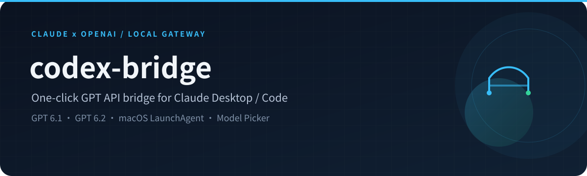
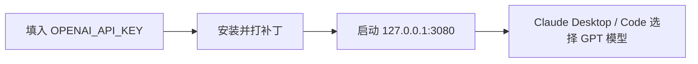

<!-- readme-visuals:header:start -->
<p align="center"></p>

<p align="center">
  <a href="https://github.com/jhihhe/codex-bridge/commits/main"></a>
  <a href="https://github.com/jhihhe/codex-bridge/stargazers"></a>
  <a href="https://github.com/jhihhe/codex-bridge/issues"></a>
  <a href="https://github.com/jhihhe"></a>
</p>
<!-- readme-visuals:header:end -->

<div align="center">

# 🌉 claude-gpt / codex-bridge

**一键把 OpenAI GPT API 接到 Claude Desktop & Claude Code**  
*One-click OpenAI GPT bridge for Claude Desktop & Claude Code*

<p>
  <b>简体中文</b> · <a href="./README_EN.md">English</a>
</p>

<p>
  
  
  
  
  
</p>

<p>
  
  
  
  
</p>

</div>

---

<!-- readme-visuals:overview:start -->

## 项目速览

<table>
<tr>
<td width="33%" valign="top"><strong>填入 API Key</strong><br><br>一条命令写入本地配置，不把密钥提交到仓库。</td>
<td width="33%" valign="top"><strong>本地 Anthropic 网关</strong><br><br>把 Claude 的请求翻译成 OpenAI Chat / Responses API。</td>
<td width="33%" valign="top"><strong>模型选择器就绪</strong><br><br>Desktop 里直接选 GPT 6.1 / 6.2，开机自动拉起代理。</td>
</tr>
</table>

### 流程概览



<!-- readme-visuals:overview:end -->

## 📸 架构示意

<p align="center">
  
</p>

```text
Claude Desktop / Claude Code
        │  Anthropic Messages API
        ▼
codex-bridge  (claude-adapter + GPT-6.x patches)
  http://127.0.0.1:3080
        │  OpenAI API
        ▼
OpenAI  GPT 6.1 / GPT 6.2   ← 你的 sk-…
```

---

## ✨ 特性

- ⚡ **一键部署**：`curl | bash` 或 `npx`，填 Key 即可
- 🧠 **GPT 6.1 / 6.2**：Astra / Sol / Terra 映射进 Claude 模型选择器
- 🧩 **兼容补丁**：Responses API、`max_completion_tokens`、丰富的 `/v1/models`
- 🖥️ **Claude Desktop Gateway**：自动写入 3p `configLibrary` 模型列表
- ⌨️ **Claude Code**：自动设置 `ANTHROPIC_BASE_URL` / `ANTHROPIC_AUTH_TOKEN`
- 🚀 **macOS 自启**：LaunchAgent + daemon wrapper，重启电脑也在
- 🩺 **doctor**：一键体检代理、配置与模型列表

### 默认模型映射

| Claude 选择器显示名 | 路由 ID | 上游 OpenAI 模型 |
|---|---|---|
| GPT 6.2 Astra | `claude-opus-4-5` | `gpt-6.2-astra` |
| GPT 6.2 Sol | `claude-sonnet-4-5` | `gpt-6.2-sol` |
| GPT 6.2 Sol Fast | `claude-haiku-4-5` | `gpt-6.2-sol` |
| GPT 6.1 Terra | `claude-opus-4-1` | `gpt-6.1-terra` |
| GPT 6.1 Sol | `claude-sonnet-4-1` | `gpt-6.1-sol` |
| GPT 6.1 Sol Fast | `claude-haiku-4-1` | `gpt-6.1-sol` |

---

## 🚀 一键安装

### 推荐

```bash
export OPENAI_API_KEY='sk-...'
curl -fsSL https://raw.githubusercontent.com/jhihhe/codex-bridge/main/install.sh | bash
```

未设置环境变量时，脚本会交互式询问 Key：

```bash
curl -fsSL https://raw.githubusercontent.com/jhihhe/codex-bridge/main/install.sh | bash
```

### 或使用 npx

```bash
npx github:jhihhe/codex-bridge setup --api-key 'sk-...'
```

### 装完后

1. **完全退出并重新打开** Claude Desktop  
2. 在模型列表选择 `GPT 6.2 *` 或 `GPT 6.1 *`  
3. 直接开聊  

---

## 🧰 常用命令

```bash
npx codex-bridge status    # 查看代理是否在跑
npx codex-bridge doctor    # 体检配置 / 端口 / 模型
npx codex-bridge stop      # 停止
npx codex-bridge start     # 启动
npx codex-bridge setup --api-key 'sk-...'   # 重新配置
npx codex-bridge patch     # 仅重打适配器补丁
```

| 项 | 默认值 |
|---|---|
| 本地端口 | `3080`（`CODEX_BRIDGE_PORT` / `--port`） |
| 适配器配置 | `~/.claude-adapter/config.json` |
| 日志 | `~/Library/Logs/codex-bridge.log` |
| LaunchAgent | `~/Library/LaunchAgents/com.jhih.codex-bridge.plist` |

---

## 📦 它做了什么

| 步骤 | 说明 |
|---|---|
| 安装 `claude-adapter@2.2.1` | Anthropic ↔ OpenAI 协议转换 |
| 写入 `~/.claude-adapter/config.json` | API Key、代理 Token、模型映射 |
| 应用 GPT-6.x 补丁 | Responses Bridge、模型路由、`/v1/models` |
| 配置 Claude Code | `ANTHROPIC_BASE_URL=http://127.0.0.1:3080` |
| 配置 Claude Desktop | Gateway + 模型选择器标签 |
| 安装 LaunchAgent | 开机自动拉起本地代理 |

---

## ✅ 环境要求

- **macOS**（Desktop Gateway / LaunchAgent 自动配置）  
  Linux / Windows 仍可把 Claude Code 指到本地代理，Desktop 需手动配置
- **Node.js 18+**
- 可用的 **OpenAI API Key**（需能调用你映射的 GPT 模型）
- 已安装 **Claude Desktop**（Gateway / 3p 模式）或 **Claude Code**

---

## 🔐 安全说明

- API Key 仅保存在本机 `~/.claude-adapter/config.json`
- 代理默认只监听 `127.0.0.1`
- **不要**把 Key 提交到 Git，也不要在 Issue / PR 里贴完整密钥
- 对话用 Project Key（`sk-proj-…`）与账单 Admin Key（`sk-admin-…`）请分开

---

## 🧹 卸载

```bash
npx codex-bridge stop
rm -f ~/Library/LaunchAgents/com.jhih.codex-bridge.plist
rm -f ~/.local/bin/codex-bridge-daemon ~/.local/bin/codex-bridge
# 可选：删除配置
# rm -rf ~/.claude-adapter ~/.codex-bridge
```

---

## 🛠️ 本地开发

```bash
git clone https://github.com/jhihhe/codex-bridge.git
cd codex-bridge
npm install
node ./bin/codex-bridge.js setup --api-key "$OPENAI_API_KEY"
node ./bin/codex-bridge.js doctor
```

---

## 📄 License

[MIT](./LICENSE) © [@Jhih he](https://github.com/jhihhe)

基于 [claude-adapter](https://www.npmjs.com/package/claude-adapter) 生态；本仓库提供一键部署、兼容补丁与 Claude Desktop 集成。

---

<div align="center">

**Made with ☕ by [@Jhih he](https://github.com/jhihhe)**

[English README](./README_EN.md) · [Issues](https://github.com/jhihhe/codex-bridge/issues) · [Stars](https://github.com/jhihhe/codex-bridge/stargazers)

</div>
