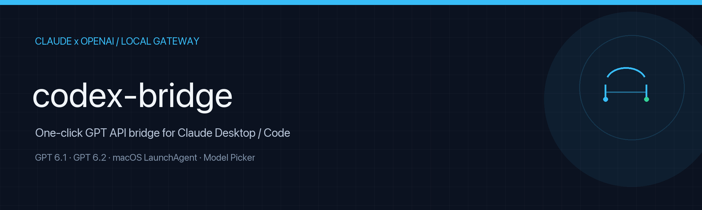
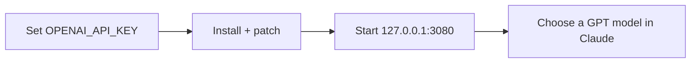

<!-- readme-visuals:header:start -->
<p align="center"></p>

<p align="center">
  <a href="https://github.com/jhihhe/codex-bridge/commits/main"></a>
  <a href="https://github.com/jhihhe/codex-bridge/stargazers"></a>
  <a href="https://github.com/jhihhe/codex-bridge/issues"></a>
  <a href="https://github.com/jhihhe"></a>
</p>
<!-- readme-visuals:header:end -->

<div align="center">

# 🌉 claude-gpt / codex-bridge

**One-click OpenAI GPT API bridge for Claude Desktop & Claude Code**  
*把 OpenAI GPT API 一键接到 Claude Desktop 与 Claude Code*

<p>
  <a href="./README.md">简体中文</a> · <b>English</b>
</p>

<p>
  
  
  
  
  
</p>

<p>
  
  
  
  
</p>

</div>

---

<!-- readme-visuals:overview:start -->

## Overview

<table>
<tr>
<td width="33%" valign="top"><strong>Drop in an API key</strong><br><br>One command writes local config — secrets never go into the repo.</td>
<td width="33%" valign="top"><strong>Local Anthropic gateway</strong><br><br>Translates Claude requests into OpenAI Chat / Responses API calls.</td>
<td width="33%" valign="top"><strong>Model picker ready</strong><br><br>Pick GPT 6.1 / 6.2 in Desktop; the proxy autostarts on login.</td>
</tr>
</table>

### Flow



<!-- readme-visuals:overview:end -->

## 📸 Architecture

<p align="center">
  
</p>

```text
Claude Desktop / Claude Code
        │  Anthropic Messages API
        ▼
codex-bridge  (claude-adapter + GPT-6.x patches)
  http://127.0.0.1:3080
        │  OpenAI API
        ▼
OpenAI  GPT 6.1 / GPT 6.2   ← your sk-…
```

---

## ✨ Features

- ⚡ **One-click setup** via `curl | bash` or `npx`
- 🧠 **GPT 6.1 / 6.2** routes exposed in Claude’s model picker
- 🧩 **Compatibility patches** for Responses API, token limits, and `/v1/models`
- 🖥️ **Claude Desktop Gateway** auto-config for 3p `configLibrary`
- ⌨️ **Claude Code** env wiring (`ANTHROPIC_BASE_URL` / token)
- 🚀 **macOS LaunchAgent** so the proxy survives reboots
- 🩺 **doctor** command to verify proxy, config, and model list

### Default model map

| Picker label | Route ID | Upstream OpenAI model |
|---|---|---|
| GPT 6.2 Astra | `claude-opus-4-5` | `gpt-6.2-astra` |
| GPT 6.2 Sol | `claude-sonnet-4-5` | `gpt-6.2-sol` |
| GPT 6.2 Sol Fast | `claude-haiku-4-5` | `gpt-6.2-sol` |
| GPT 6.1 Terra | `claude-opus-4-1` | `gpt-6.1-terra` |
| GPT 6.1 Sol | `claude-sonnet-4-1` | `gpt-6.1-sol` |
| GPT 6.1 Sol Fast | `claude-haiku-4-1` | `gpt-6.1-sol` |

---

## 🚀 Install

### Recommended

```bash
export OPENAI_API_KEY='sk-...'
curl -fsSL https://raw.githubusercontent.com/jhihhe/codex-bridge/main/install.sh | bash
```

Without an env var, the script prompts for the key:

```bash
curl -fsSL https://raw.githubusercontent.com/jhihhe/codex-bridge/main/install.sh | bash
```

### Or use npx

```bash
npx github:jhihhe/codex-bridge setup --api-key 'sk-...'
```

### After install

1. **Fully quit and reopen** Claude Desktop  
2. Pick `GPT 6.2 *` or `GPT 6.1 *` in the model list  
3. Start chatting  

---

## 🧰 Commands

```bash
npx codex-bridge status
npx codex-bridge doctor
npx codex-bridge stop
npx codex-bridge start
npx codex-bridge setup --api-key 'sk-...'
npx codex-bridge patch
```

| Item | Default |
|---|---|
| Port | `3080` (`CODEX_BRIDGE_PORT` / `--port`) |
| Adapter config | `~/.claude-adapter/config.json` |
| Log | `~/Library/Logs/codex-bridge.log` |
| LaunchAgent | `~/Library/LaunchAgents/com.jhih.codex-bridge.plist` |

---

## 📦 What setup does

| Step | Detail |
|---|---|
| Install `claude-adapter@2.2.1` | Anthropic ↔ OpenAI translation |
| Write `~/.claude-adapter/config.json` | API key, proxy token, model map |
| Apply GPT-6.x patches | Responses bridge, routes, `/v1/models` |
| Configure Claude Code | `ANTHROPIC_BASE_URL=http://127.0.0.1:3080` |
| Configure Claude Desktop | Gateway + picker labels |
| Install LaunchAgent | Autostart local proxy |

---

## ✅ Requirements

- **macOS** for automatic Desktop Gateway / LaunchAgent setup  
  Linux / Windows can still point Claude Code at the local proxy
- **Node.js 18+**
- A working **OpenAI API key** for the mapped models
- **Claude Desktop** (Gateway / 3p mode) and/or **Claude Code**

---

## 🔐 Security

- API keys stay on-disk in `~/.claude-adapter/config.json`
- Proxy binds to `127.0.0.1` by default
- Never commit keys or paste full secrets into issues/PRs
- Keep chat Project keys (`sk-proj-…`) separate from Admin keys (`sk-admin-…`)

---

## 🧹 Uninstall

```bash
npx codex-bridge stop
rm -f ~/Library/LaunchAgents/com.jhih.codex-bridge.plist
rm -f ~/.local/bin/codex-bridge-daemon ~/.local/bin/codex-bridge
# optional: rm -rf ~/.claude-adapter ~/.codex-bridge
```

---

## 🛠️ Development

```bash
git clone https://github.com/jhihhe/codex-bridge.git
cd codex-bridge
npm install
node ./bin/codex-bridge.js setup --api-key "$OPENAI_API_KEY"
node ./bin/codex-bridge.js doctor
```

---

## 📄 License

[MIT](./LICENSE) © [@Jhih he](https://github.com/jhihhe)

Built around the [claude-adapter](https://www.npmjs.com/package/claude-adapter) ecosystem, with deploy scripts, compatibility patches, and Claude Desktop integration.

---

<div align="center">

**Made with ☕ by [@Jhih he](https://github.com/jhihhe)**

[中文 README](./README.md) · [Issues](https://github.com/jhihhe/codex-bridge/issues) · [Stars](https://github.com/jhihhe/codex-bridge/stargazers)

</div>
